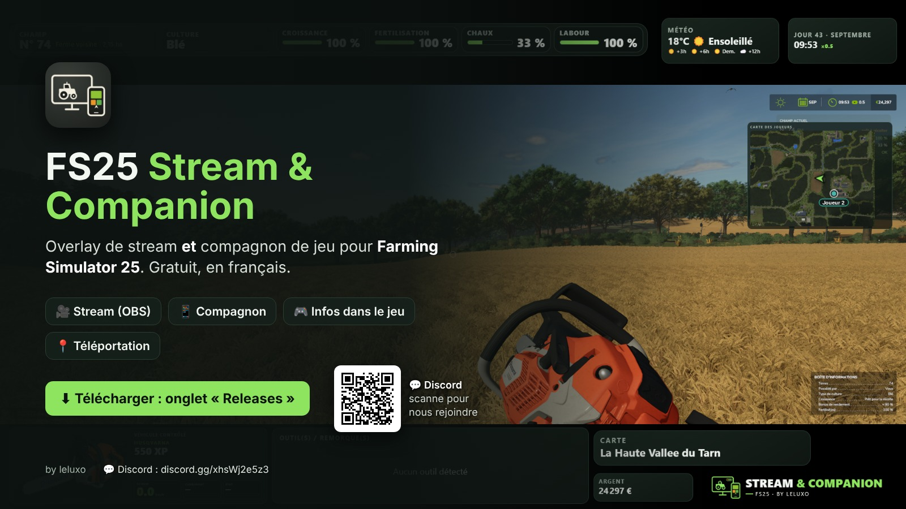
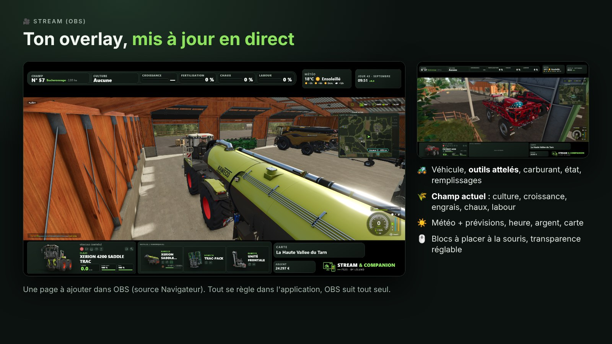
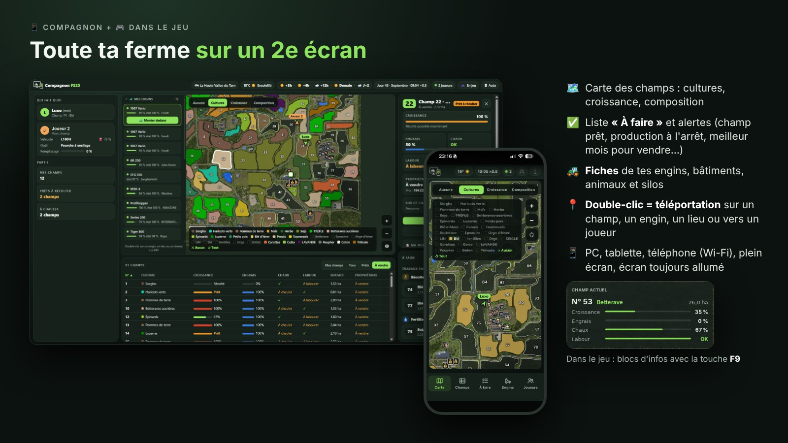

# FS25 Stream & Companion — by leluxo

Overlay de stream **et** compagnon de jeu pour **Farming Simulator 25**.

> ⚠️ **Mod non officiel** pour Farming Simulator 25, gratuit, non affilié à GIANTS Software. Farming Simulator est une marque de GIANTS Software. — *Unofficial, free mod for Farming Simulator 25, not affiliated with GIANTS Software.*

- 🎥 **Stream (OBS)** : ton véhicule, tes outils, le champ, la météo, l'argent… dans une page à ajouter dans OBS.
- 📱 **Compagnon** : sur téléphone, tablette ou 2e écran : carte des champs, fiches des champs, engins, bâtiments, animaux et silos, liste « À faire », alertes, qui fait quoi, téléportation en double-clic (aussi vers un joueur), écran toujours allumé.
- 🎮 **Dans le jeu** : blocs d'infos (À faire, Qui fait quoi, Prévisions météo, Champ actuel, Dernières alertes), touche **F9** pour les ouvrir / fermer (modifiable dans Options > Commandes du jeu). Alertes : champ prêt, production à l'arrêt, stock plein, animaux, meilleur mois pour vendre.
- 🔄 **Mises à jour en 1 clic** depuis la fenêtre d'accueil de l'application (à partir de la 1.4.3).

## ⬇️ Télécharger

La dernière version est dans **[Releases](../../releases/latest)** : télécharge le fichier d'installation (.exe) et lance-le. C'est le seul fichier nécessaire.

- Windows affiche « Windows a protégé votre ordinateur » : clique sur « Informations complémentaires » puis « Exécuter quand même ».
- Pas besoin de désinstaller l'ancienne version : tes réglages sont gardés.
- L'application installe et met à jour le mod toute seule.
- **Multijoueur** : le serveur (dédié ou hôte) doit avoir la même version du mod. Après avoir lancé le jeu une fois avec l'app, prends `FS25_StreamDashboard.zip` dans ton dossier mods (Documents\My Games\FarmingSimulator2025\mods) et copie-le dans le dossier mods du serveur.
- **Crossplay (PlayStation / Xbox)** : l'application et le mod sont **pour PC uniquement**. Les joueurs console ne peuvent pas installer le mod, donc ils ne pourront pas rejoindre un serveur où il est installé. Pour jouer avec des joueurs console, il faut retirer le mod du serveur.

## 💬 Aide et communauté

- Discord « La Ferme à Luxo » : https://discord.gg/xhsWj2e5z3
- Soutenir le projet : https://ko-fi.com/leluxo

## License

FS25 Stream & Companion is free and open source software, released under the [MIT License](LICENSE).
Original idea, design and author: **leluxo (LeLuxo)**.

## Code signing policy

Free code signing provided by [SignPath.io](https://signpath.io), certificate by [SignPath Foundation](https://signpath.org).

- Committers and reviewers: [leluxo75](https://github.com/leluxo75)
- Approvers: [leluxo75](https://github.com/leluxo75)

Every release is built from this repository by GitHub Actions (`.github/workflows/fabrication.yml`).
Each signing request is manually approved by the approver above.

## Privacy policy

The program only contacts the following systems:

- **Update check (automatic):** asks GitHub (api.github.com) for the latest release number of this repository, and downloads the installer from GitHub if you accept an update. No personal data is sent.
- **Automatic vehicle image search (can be turned off in the settings):** sends the vehicle / implement name to an image search engine (DuckDuckGo, Bing, or Google if you enter your own API key), then downloads the chosen picture from the site that hosts it.
- **Companion mode:** the app serves a web page on your local network so your phone can connect; nothing goes through an external server.

No account, no analytics, no tracking. All settings stay on your PC.

## Uninstall

Windows Settings > Apps > "FS25 Stream & Companion by leluxo" > Uninstall. The uninstaller also removes the mod and the app data.
